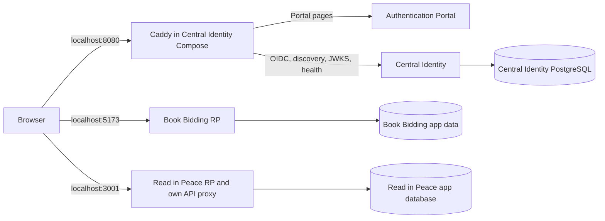
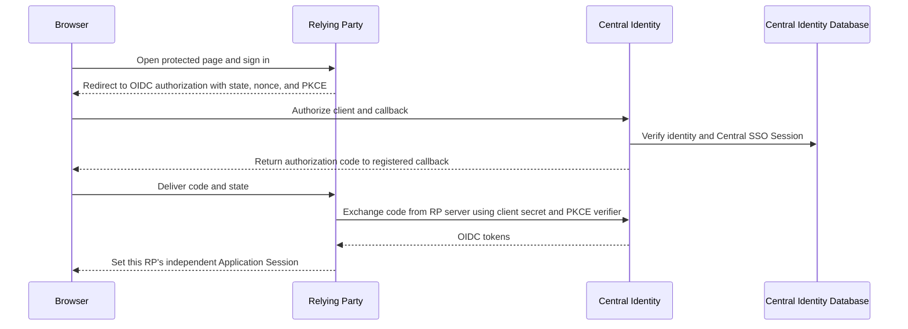

# Central Identity

## Purpose

This repository runs Central Identity as an independently deployable OpenID
Connect identity provider (IdP). Applications register as separate Relying
Parties (RPs). Central Identity owns identity credentials and its SSO Session;
each RP owns its users, application data, and Application Sessions.

## Connected projects

| Project | Role | Local development origin |
| --- | --- | --- |
| `book-auth-middleware` | Central Identity IdP, Authentication Portal, and local HTTP gateway | `http://localhost:8080` |
| `book-bidding` | OIDC RP; keeps its own Application Sessions and data | `http://localhost:5173` |
| `read-in-peace` | OIDC RP; keeps its own Application Sessions and data | `http://localhost:3001` |
| `sso-edge` | Independent production HTTPS ingress; not part of local development | Production hostnames |

Central Identity's local Caddy serves only the IdP at `http://localhost:8080`.
Book Bidding and Read in Peace serve their own HTTP development origins; both
share `localhost` cookies with the IdP only when cookie names differ.



## API endpoints

Use `http://localhost:8080` as the development API origin.

| Endpoint | Responsibility |
| --- | --- |
| `GET /health/live` | Reports whether the identity server is responding. Does not check PostgreSQL. |
| `GET /health/ready` | Checks PostgreSQL readiness; returns `503` when the database is unavailable. |
| `GET /api/auth/config` | Tells the portal whether configured social sign-in options are available. |
| `GET /api/auth/relying-party-destination?client_id=…&redirect_uri=…` | Checks that an RP callback is registered and returns its origin for portal sign-in continuation. Rejects unknown or unregistered callbacks. |
| `/api/auth/*` | Better Auth account and session API: credential sign-up/sign-in, email verification, password reset, session handling, and configured social sign-in. |
| `GET /api/auth/.well-known/openid-configuration` | OIDC discovery metadata: issuer and protocol endpoint URLs. RPs use it to configure OIDC. |
| `GET /api/auth/oauth2/authorize` | Starts an RP authorization. Checks the client and callback, authenticates the Central Identity, and returns a code to the registered callback. |
| `POST /api/auth/oauth2/token` | Exchanges an authorization code for OIDC tokens. RP server authenticates with its client secret and PKCE verifier. |
| Discovery's `userinfo_endpoint` | Returns identity claims for a valid bearer access token. |
| Discovery's `jwks_uri` | Publishes public signing keys so RPs can validate ID tokens. |

The Authentication Portal serves sign-in, registration, and password recovery
pages. Caddy routes portal pages to `web`; health, account, discovery, and OIDC
API requests go to the Elysia/Better Auth server. Provisioning clients is an
operator CLI operation, not a public registration endpoint.

## Setup

Use three sibling checkouts: `book-auth-middleware/`, `book-bidding/`, and
`read-in-peace/`. Install Bun 1.4.2 or newer, Docker Engine with Compose, and
the repository's development dotenvx keys. Never share or commit keys or client
secrets. Port `8080` must be free.

Run the ordinary development stack from `book-auth-middleware/`:

```sh
bun run dev
```

This serves Central Identity at `http://localhost:8080`, uses existing named
database and service volumes, and does not alter client or identity data.
Use email/password for local sign-in. Google and GitHub callbacks are deferred
and unverified for this HTTP flow; do not rely on them.
The gateway binds to loopback; do not expose this development stack to a network.

Follow the [Development SSO workflow](docs/local-oauth-sso.md) to provision
separate OIDC clients and register exact callbacks. Do not use production data
or credentials for local tests.

## Run local integration

Run `bun run dev` once from `book-auth-middleware/`. In separate
terminals, start each RP from its own checkout:

```sh
cd ../book-bidding
bun run dev
```

```sh
cd ../read-in-peace
npm run dev
```

Central Identity and both RPs use HTTP localhost origins in development. No
local CA or hostname setup is required.

Check Central Identity and OIDC discovery:

```sh
curl --fail http://localhost:8080/health/ready
curl --fail http://localhost:8080/api/auth/.well-known/openid-configuration \
  | jq -e '.issuer == "http://localhost:8080/api/auth"'
```

Then open `http://localhost:5173` and sign in. In the same browser profile,
open `http://localhost:3001`. Read in Peace should reuse the
Central SSO Session but create its own Application Session. Signing out of one
RP leaves the other RP's session active. Signing out of Central Identity
requires authentication on the next authorization; it does not revoke existing
RP sessions.

The OIDC path is:



The browser carries the authorization code, not the RP client secret. Each RP
validates the OIDC response and creates its own Application Session. Matching
email addresses alone never link or claim an existing application account.

For repeatable cross-app browser coverage, run from `book-bidding/` with a
dedicated verified Central Identity test account:

```sh
read -r -p "Central Identity test email: " CENTRAL_IDENTITY_TEST_EMAIL
read -r -s -p "Central Identity test password: " CENTRAL_IDENTITY_TEST_PASSWORD
printf '\n'
export CENTRAL_IDENTITY_TEST_EMAIL CENTRAL_IDENTITY_TEST_PASSWORD
BIDDING_OIDC_TEST_ORIGIN=http://localhost:5173 \
  READING_OIDC_TEST_ORIGIN=http://localhost:3001 \
  CENTRAL_IDENTITY_TEST_ORIGIN=http://localhost:8080 \
  bun run test:oidc-browser
unset CENTRAL_IDENTITY_TEST_EMAIL CENTRAL_IDENTITY_TEST_PASSWORD
```

The browser test requires all three projects running and provisioned. It
verifies live OIDC sign-in and RP session boundaries. It does not test
Google/GitHub sign-in or account recovery.

Stop the app processes with Ctrl+C. Stop Central Identity without deleting its
persistent database or service volumes:

```sh
bunx dotenvx run --strict --overload -f .env.development -- docker compose --env-file /dev/null down
```

Do not add `-v` unless intentionally deleting local database and service data.

## Production

Central Identity, its RPs, and `sso-edge` deploy independently. Production
ingress and rollback instructions are in the
[`sso-edge` operations guide](../sso-edge/README.md). Local setup does not prove
production DNS, TLS, backups, or SSO.
